  <picture>
    <source media="(prefers-color-scheme: dark)" srcset="./assets/profile-header-dark.svg">
    <source media="(prefers-color-scheme: light)" srcset="./assets/profile-header-light.svg">
    
  </picture>

 

  &nbsp;
  &nbsp;
  &nbsp;
  

---

### Overview

I am the founder of **[ACHORD](https://achord.io)**. I engineer software systems that eliminate operational bottlenecks and deliver deterministic reliability for enterprises and developers.

| Domain | Engineering Scope |
| :--- | :--- |
| **Enterprise Platforms** | Distributed business backends, regulatory compliance engines, and event-driven workflow architectures. |
| **Developer Ecosystems** | High-trust collaboration platforms, autonomous workflow sidecars, and developer productivity tooling. |
| **Native Systems** | High-performance macOS and Apple ecosystem applications engineered natively with Swift. |

---

### Open-Source Public Engines

| Repository | Architecture & Scope |
| :--- | :--- |
| **[ESNAFÇA (`itisbehrouz/Esnafca`)](https://github.com/itisbehrouz/Esnafca)** | Open-source local commerce engine featuring Leaflet geospatial clustering, dynamic QR discovery, and a Zero-Trust administrative workstation. |
| **[KARMİS (`itisbehrouz/karmis`)](https://github.com/itisbehrouz/karmis)** | Open-source, deterministic career decision engine driven by local-first SQLite scoring algorithms and zero telemetry. |

---

### Architectural Principles

- **Deep Interfaces:** Deep modules with clean seams that hide operational complexity behind simple abstractions.
- **Deterministic Reliability:** Predictable state machines, strict data contracts, and zero-telemetry local-first architectures.
- **Operational Clarity:** Real-time event streams, RFC 7807 standard error contracts, and immutable audit trails.

---

### Strategic Collaboration

I collaborate with founders, technical directors, and engineering organizations on:

- Distributed systems design, concurrency control, and zero-trust backend perimeters.
- Local-first data architecture, deterministic decision engines, and edge performance.
- Systems audit, technical debt elimination, and engineering workflow optimization.
